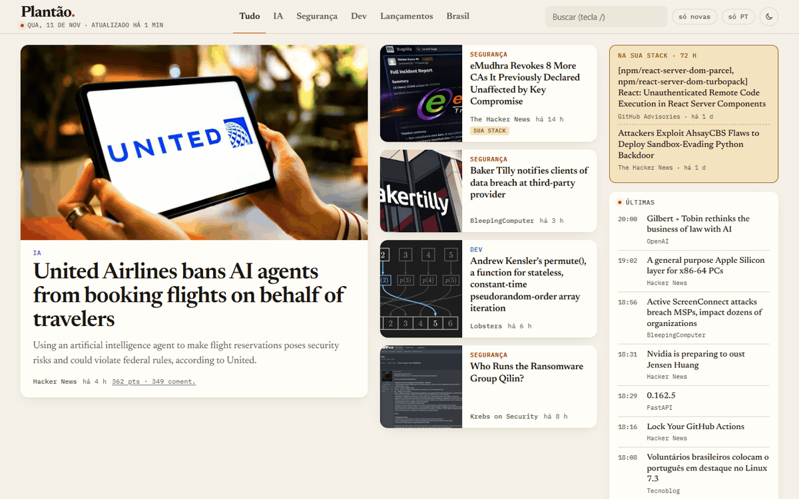
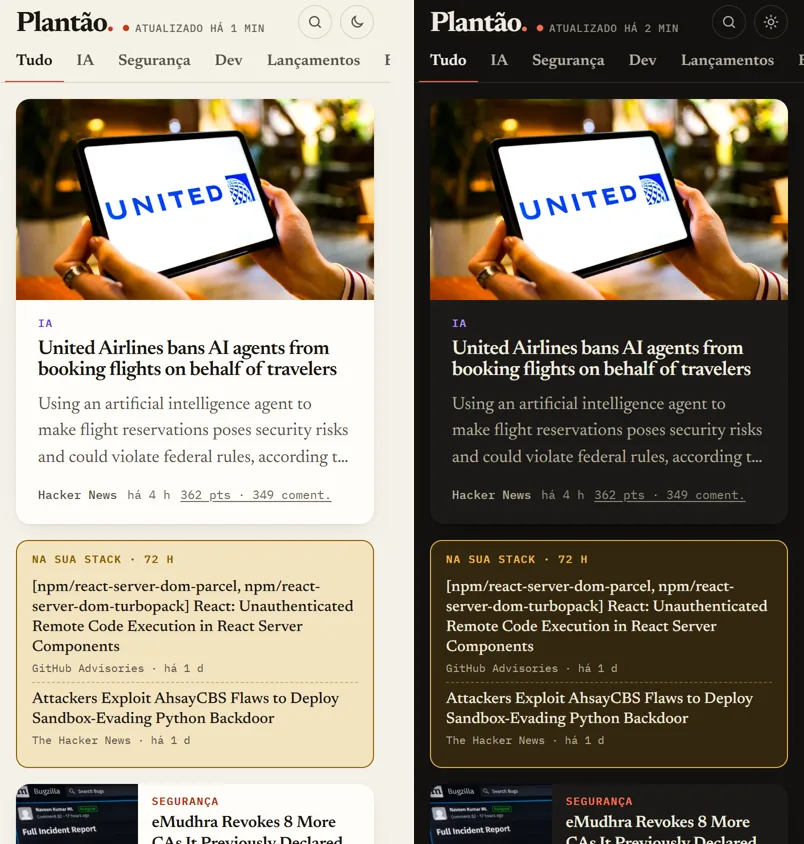

# Plantão.

**Jornal de tecnologia que se monta sozinho.** Junta 26 fontes (RSS, Hacker News, CISA e GitHub Advisories), classifica cada notícia por editoria e publica uma capa nova várias vezes por dia, sem servidor e sem banco de dados.

[](https://github.com/LuizAugustodev/plantao/actions/workflows/atualizar.yml)


### [→ Abrir o Plantão](https://luizaugustodev.github.io/plantao/)



## O que ele faz

- **Capa de jornal de verdade:** manchete, destaques, chapéu, linha fina e "Últimas" em ordem de chegada. A manchete sai de uma nota que pesa novidade, foto, pontos no Hacker News e se o assunto é da minha stack.
- **Cinco editorias:** IA, Segurança, Dev, Lançamentos e Brasil. A categoria vem da fonte e é corrigida por palavras-chave.
- **Alerta "na sua stack":** falha de segurança ou notícia que cita React, FastAPI, PostgreSQL e o resto do que eu uso aparece em destaque por 72 h.
- **"Novo" desde a última visita**, busca com a tecla `/`, filtro "só PT", tema claro e escuro.
- **Mesma notícia de fontes diferentes não se repete na capa**, e promoção ou guia de compra nunca entra.
- **Curtas:** notícia sem foto e sem resumo vira lista compacta do dia, em vez de cartão vazio.



## Como funciona

```
GitHub Actions (agendado)
  └─ coletar.mjs     RSS/Atom · Hacker News (Algolia) · CISA KEV · GitHub Advisories
     └─ enriquecer.mjs   og:image e og:description quando o feed não traz (com cache)
        └─ build.mjs       index.html com as notícias embutidas + noticias.json
           └─ GitHub Pages
```

## Decisões

- **Sem framework e sem API em tempo real.** Um HTML só, com as notícias embutidas: a capa aparece sem esperar requisição nenhuma.
- **Fonte que cai não derruba a edição.** Cada coleta é isolada; o rodapé mostra quais fontes estão fora do ar.
- **Fotos reduzidas e em WebP** pelo [wsrv.nl](https://wsrv.nl). Se a foto quebrar, o cartão vira capa tipográfica na cor da editoria.
- **Tipografia de jornal:** Newsreader nos títulos, IBM Plex Mono nos metadados, servidas pelo próprio site (nada de CSS externo travando a primeira pintura).

## Rodar local

```bash
npm ci
npm run dev   # build + servidor em http://localhost:4321
```

Fonte nova: acrescentar em `src/fontes.mjs` (`FONTES`), rodar `npm run build` e conferir se aparece "ok" no log.

---

Feito por [Luiz Augusto](https://github.com/LuizAugustodev), dev full stack em Cuiabá. Também faço sites na [Ziul](https://ziul.com.br).
